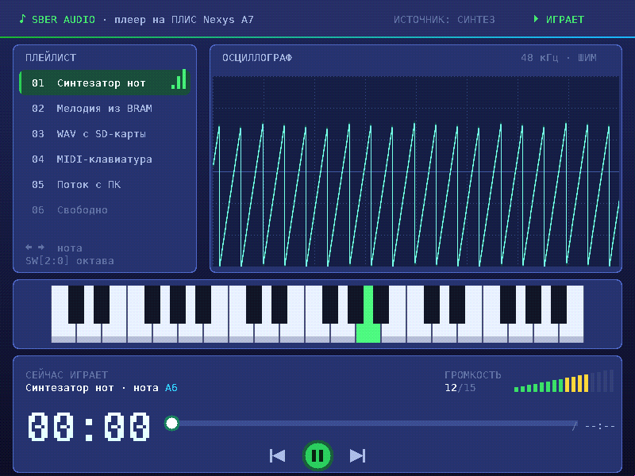

# audio_nexys_a7

Демонстрационный проект для хакатона на плате Digilent Nexys A7 (ПЛИС `xc7a100tcsg324-1`). Ваша задача — сделать на его основе **музыкальный плеер**.

Сам демо-проект — аппаратный синтезатор нот на SystemVerilog. DDS-генератор формирует звук, ШИМ выводит его на аудиовыход платы. На VGA-монитор выводятся логотип и текст, на семисегментных индикаторах видны текущая нота и октава. Синтезатор управляется кнопками и переключателями платы.

С чего начать:

1. [Описание демо-проекта](<doc/3_Описание демо.md>): модули, клоки, симулятор, сборка и прошивка платы.
2. [Теория](doc/1_О_цифровом_звуке.md): цифровой звук, ноты, DDS, ШИМ, WAV, MP3, где хранить музыку на плате.
3. [Критерии оценки](doc/criteria.md).
4. [Зависимости](DEPENDENCIES.md): что должно быть установлено на ноутбуке.

## Быстрый старт

```bash
make deploy                        # создать проект Vivado в ./vivado и открыть GUI
cd src/sim && make && ./obj_dir/audio   # симулятор на Verilator: звук, VGA и индикаторы в окне
```

## Структура файлов

```
audio_nexys_a7/
├── README.md                    этот файл
├── DEPENDENCIES.md              необходимые программы и команды установки
├── Makefile                     make deploy — создать проект Vivado, make clear — удалить его
├── CLAUDE.md                    заметки о проекте для Claude Code
├── plan.md                      известные недоработки демо-проекта
├── shim.md                      конспект: как пила DDS превращается в ШИМ
├── doc/
│   ├── 1_О_цифровом_звуке.md    теория по звуку
│   ├── 2_О работе графики.pdf   теория по VGA
│   ├── 3_Описание демо.md       описание демо-проекта
│   ├── 4_Инструкция_Vivado.pdf  работа в Vivado по шагам
│   ├── criteria.md              критерии оценки
│   ├── nexys-a7_rm.pdf          документация на плату (Reference Manual)
│   └── image/                   картинки к описанию демо
└── src/
    ├── top/
    │   ├── audio_nexys_a7.sv    топовый модуль: всё соединяется здесь
    │   └── audio_nexys_a7.xdc   выводы ПЛИС и ограничения по клокам
    ├── rtl/                     модули проекта
    │   ├── button_debouncer.sv        подавление дребезга кнопок
    │   ├── reset_button_debouncer.sv  сброс от кнопки CPU_RESETN и PLL
    │   ├── reset_sync.sv              синхронизатор сброса для клокового домена
    │   ├── button_ctrl.sv             play/pause, громкость, выбор ноты
    │   ├── tone_generator.sv          DDS-генератор ноты
    │   ├── fifo.sv                    буфер сэмплов
    │   ├── pwm.sv                     ШИМ на аудиовыход
    │   ├── sevseg_ctrl.sv             семисегментные индикаторы
    │   ├── display_ctrl.sv            тайминги VGA 800×600@60
    │   ├── player_screen.sv           всё между звуком и VGA: таймер, CDC статуса, осциллограф, интерфейс
    │   ├── vga_ui.sv                  экран плеера (текст, осциллограф, пианино, прогресс, громкость)
    │   ├── scope_capture.sv           буфер осциллографа с триггером и двойной буферизацией
    │   ├── cdc_bus.sv                 передача статуса между клоковыми доменами (handshake)
    │   ├── play_timer.sv              время воспроизведения mm:ss в BCD
    │   ├── async_fifo.sv              асинхронный FIFO (Gray-указатели, BRAM) для SD / UART / CPU
    │   ├── mem/font8x16.mem           шрифт 8×16 CP866 с кириллицей (tools/gen_font.py)
    │   ├── mem/screen_text.mem        статичный текст экрана (tools/gen_screen.py)
    │   ├── vga_demo.sv                старая демо-картинка (не используется)
    │   ├── sber_logo_rom.sv           логотип 128×128
    │   └── font_rom.sv                шрифт 8×8 (не используется)
    ├── ipcores/clk_wiz_0/       Clocking Wizard (clk_wiz_0.xci): клоки 49.159, 4.993 и 39.941 МГц
    ├── sim/                     симулятор на Verilator + SDL2
    │   ├── top_audio.sv         топ для симулятора (без PLL и дебаунсеров)
    │   ├── main_audio.cpp       окно, звук, клавиатура
    │   └── Makefile
    ├── tb/tb_audio_nexys_a7.sv  тестбенч для симулятора Vivado
    ├── tb/tb_async_fifo.sv      самопроверяющийся тест async_fifo
    ├── tb/tb_vga_ui.sv          рендер кадра vga_ui в файл (без Vivado)
    └── tcl/deploy.tcl           скрипт создания проекта Vivado
tools/
├── gen_font.py                  шрифт → src/rtl/mem/font8x16.mem
├── gen_screen.py                надписи на экране → src/rtl/mem/screen_text.mem
└── frame_to_png.py              кадр из tb_vga_ui → PNG
```

## Экран плеера



Кадр получен моделированием всего тракта симулятора (`src/sim/top_audio.sv`) в Icarus Verilog. Ещё есть [пауза](doc/image/ui_pause.png) и [заставка](doc/image/ui_splash.png).

Надписи меняются в `tools/gen_screen.py` (там же список ячеек, которые экран обновляет сам), затем:

```bash
python3 tools/gen_screen.py        # нужен Python 3; для gen_font.py ещё pip install pillow
```

Посмотреть кадр без платы и без Vivado (Icarus Verilog, ~1 минута):

```bash
iverilog -g2012 -o /tmp/ui -s tb_vga_ui src/rtl/display_ctrl.sv src/rtl/sber_logo_rom.sv src/rtl/vga_ui.sv src/tb/tb_vga_ui.sv
cd src/rtl/mem && vvp -n /tmp/ui +FRAMES=2 +OUT=/tmp/frame.txt && cd -
python3 tools/frame_to_png.py /tmp/frame.txt frame.png
```

Тест асинхронного FIFO:

```bash
iverilog -g2012 -o /tmp/fifo src/rtl/async_fifo.sv src/tb/tb_async_fifo.sv && vvp -n /tmp/fifo
```

Новые RTL-файлы кладите в `src/rtl/`: `deploy.tcl` добавляет в проект всё, что лежит в `src/rtl/` и `src/top/`, включая файлы `*.mem` из `src/rtl/`. Папка репозитория может называться как угодно: top-модуль задан в `deploy.tcl` явно. Если файл добавлен после `make deploy`, запустите `make deploy` ещё раз или добавьте файл в проект вручную в Vivado.
