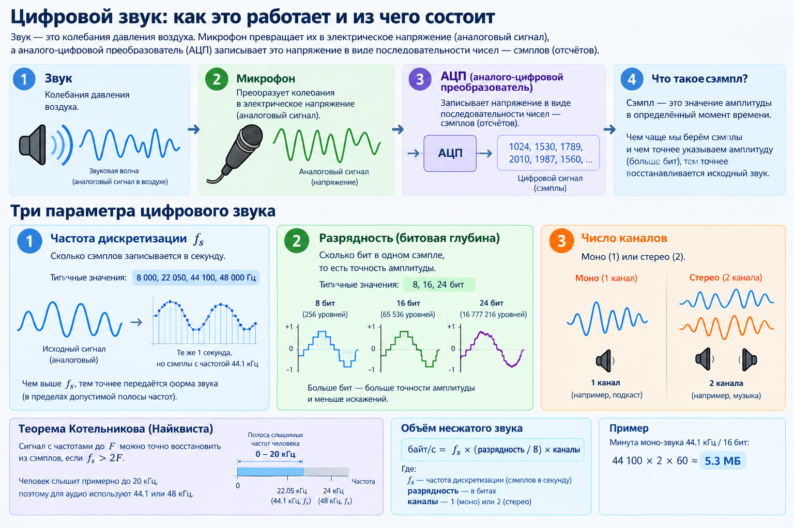
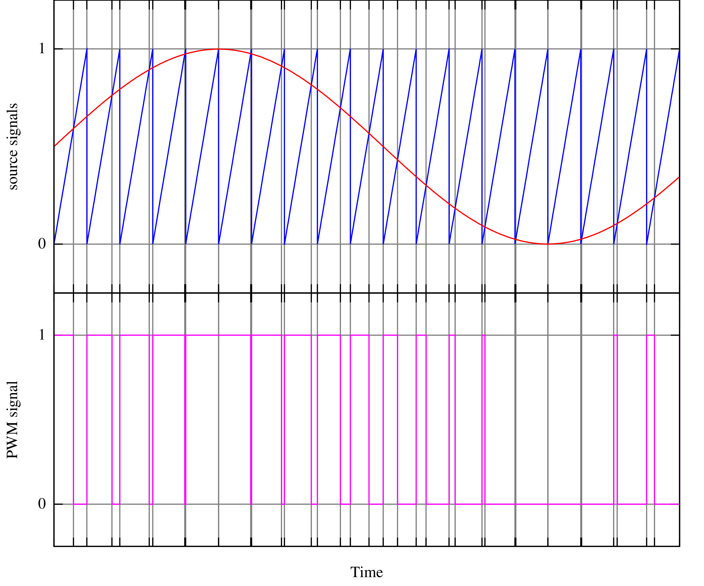

# Цифровой звук на ПЛИС

Документ собирает теорию, которая понадобится для музыкального плеера на Nexys A7: как звук представляется в цифре, как синтезировать ноты, как вывести звук через ШИМ и как устроены форматы WAV и MP3. Там, где это возможно, теория привязана к коду демо-проекта.

## Содержание

1. [Цифровой звук](#1-цифровой-звук)
2. [Ноты и их частоты](#2-ноты-и-их-частоты)
3. [Прямой цифровой синтез (DDS)](#3-прямой-цифровой-синтез-dds)
4. [Вывод звука через ШИМ](#4-вывод-звука-через-шим)
5. [Тракт воспроизведения: буфер, громкость, частота дискретизации](#5-тракт-воспроизведения-буфер-громкость-частота-дискретизации)
6. [Формат WAV](#6-формат-wav)
7. [Формат MP3](#7-формат-mp3)
8. [Где хранить музыку на плате](#8-где-хранить-музыку-на-плате)
9. [Источники](#9-источники)

---

## 1. Цифровой звук

Звук — это колебания давления воздуха. Микрофон превращает их в электрическое напряжение (аналоговый сигнал), а аналого-цифровой преобразователь (АЦП) записывает это напряжение в виде последовательности чисел — **сэмплов** (отсчётов).

Цифровой звук описывают три параметра:

| Параметр | Что означает | Типичные значения |
|---|---|---|
| Частота дискретизации `f_s` | Сколько сэмплов записывается в секунду | 8 000, 22 050, 44 100, 48 000 Гц |
| Разрядность (битовая глубина) | Сколько бит в одном сэмпле, то есть точность амплитуды | 8, 16, 24 бит |
| Число каналов | Моно (1) или стерео (2) | 1, 2 |

**Теорема Котельникова (Найквиста):** сигнал с частотами до `F` можно точно восстановить из сэмплов, если `f_s > 2F`. Человек слышит примерно до 20 кГц, поэтому для аудио используют 44.1 или 48 кГц.

Объём несжатого звука легко посчитать:

```
байт/с = f_s × (разрядность / 8) × каналы
```

Например, минута моно-звука 44.1 кГц / 16 бит занимает 44 100 × 2 × 60 ≈ **5.3 МБ**. Это в 8–9 раз больше всей блочной памяти ПЛИС на плате (см. [раздел 8](#8-где-хранить-музыку-на-плате)).



## 2. Ноты и их частоты

В современной музыке используется **равномерно темперированный строй**: октава (удвоение частоты) делится на 12 полутонов, и соседние полутона отличаются по частоте в `2^(1/12) ≈ 1.0595` раза. Опорная нота — ля первой октавы (A4) = 440 Гц.

Частота любой ноты:

```
f = 440 × 2^((n − 69) / 12)
```

где `n` — номер ноты в нумерации MIDI (A4 = 69, C4 = 60).

Частоты 4-й октавы (в русской нотации — первой):

| Нота | Обозначение | Частота, Гц | | Нота | Обозначение | Частота, Гц |
|---|---|---|---|---|---|---|
| До | C4 | 261.63 | | До# | C#4 | 277.18 |
| Ре | D4 | 293.66 | | Ре# | D#4 | 311.13 |
| Ми | E4 | 329.63 | | Фа# | F#4 | 369.99 |
| Фа | F4 | 349.23 | | Соль# | G#4 | 415.30 |
| Соль | G4 | 392.00 | | Ля# | A#4 | 466.16 |
| Ля | A4 | 440.00 | | | | |
| Си | B4 | 493.88 | | | | |

Переход на октаву вверх удваивает частоту, на октаву вниз — делит её пополам. В демо-проекте октава выбирается переключателями `SW[2:0]`: частота ноты 4-й октавы сдвигается на нужное число бит влево или вправо (`src/rtl/tone_generator.sv`).

**Мелодия** — это последовательность пар «нота + длительность» (плюс паузы). Длительности считают от темпа: при 120 ударах в минуту четвертная нота длится 0.5 с, то есть ≈ 24 003 сэмпла при `f_s` = 48 006 Гц. Такую последовательность удобно хранить в блочной памяти и читать счётчиком.

## 3. Прямой цифровой синтез (DDS)

**DDS (Direct Digital Synthesis)** — способ получить сигнал заданной частоты с помощью счётчика-аккумулятора.

На каждом сэмпле к N-битному **фазовому аккумулятору** прибавляется **инкремент** (шаг фазы). Аккумулятор переполняется и начинает заново — один период выходного сигнала соответствует одному полному обороту аккумулятора:

```
f_out = increment × f_s / 2^N        →        increment = f_out × 2^N / f_s
```

Для N = 32 и `f_s` = 48 006.1 Гц:

| Нота | f, Гц | increment (десятичный) | increment (hex) |
|---|---|---|---|
| C4 | 261.63 | 23 407 280 | `32'h01652AB0` |
| A4 | 440.00 | 39 365 528 | `32'h0258AB98` |

Шаг настройки частоты — `f_s / 2^32` ≈ 0.00001 Гц, то есть частоту можно задать практически точно.

> **Важно:** инкремент зависит от `f_s`. Если меняется тактовая частота или период ШИМ, инкременты нужно пересчитать, иначе все ноты сдвинутся по высоте.

### Форма волны

Значение аккумулятора — это **фаза**. Из фазы можно получить разные формы сигнала:

| Форма | Как получить из фазы `acc` | Звучание |
|---|---|---|
| Пила | старшие биты `acc` напрямую (так сделано в демо: `sample = acc[31:16]`) | резкое, «жужжащее» |
| Меандр | старший бит `acc[31]`, растянутый на всю разрядность | «электронное», как у 8-битных приставок |
| Треугольник | `acc[31] ? ~acc[30:15] : acc[30:15]` | мягче пилы |
| Синус | таблица синуса (LUT) в памяти, адрес — старшие биты `acc` | чистый тон |

Для синуса удобно хранить в блочной памяти таблицу, например 256 значений на период. Можно хранить только четверть периода и восстанавливать остальное по симметрии.

> **Куда копать, чтобы демо звучало приятнее.** Демо-генератор выдаёт пилу — у неё много высоких гармоник, поэтому звук резкий. Попробуйте заменить пилу синусом. Вопросы, на которые придётся ответить:
> - Какие биты фазы `duty` подать на адрес таблицы и сколько значений в ней хранить, чтобы не было слышно «ступенек»?
> - Чем заполнить таблицу? Подсказка: таблицу можно сгенерировать скриптом (Python) в файл для `$readmemh`.
> - Синус бывает отрицательным, а ШИМ принимает только беззнаковое число. Как сдвинуть таблицу (см. [раздел 5](#знаковые-и-беззнаковые-сэмплы))?
> - Чтение из блочной памяти занимает такт. Как это повлияет на `valid`/`ready` и запись в FIFO?


### Как сделано в демо-проекте

`src/rtl/tone_generator.sv`:
- 32-битный аккумулятор `duty` растёт на `increment`, когда потребитель готов принять сэмпл (`valid && ready`);
- Первые 256 значений записваются в FIFO, и вычитываются раз за сэмпл (здесь есть задержка перехода между нотами);
- `increment` выбирается по номеру ноты (`note_index`) и сдвигается по октаве (`octave_sel`);
- Высокие ноты дают более частые зубцы пилы (зубец формируется за меньшее количество семплов), низкие ноты дают более длинные зубцы;
- выход — пила `sample = duty[31:16]` (16 бит, без знака).

## 4. Вывод звука через ШИМ

### Принцип

**Широтно-импульсная модуляция (ШИМ, PWM)** — способ получить «аналоговое» напряжение с цифрового вывода, у которого есть только 0 и 1. Вывод переключается с постоянной частотой, а меняется **коэффициент заполнения** (duty cycle) — доля периода, в которой сигнал равен 1. Среднее напряжение за период пропорционально коэффициенту заполнения: при заполнении 25% и питании 3.3 В среднее значение ≈ 0.8 В.

Если пропустить ШИМ-сигнал через **фильтр нижних частот (ФНЧ)**, несущая частота ШИМ и её гармоники подавляются, и остаётся медленно меняющаяся огибающая — исходный звуковой сигнал. Чтобы несущая не была слышна, частота ШИМ должна быть намного выше частоты среза фильтра: Digilent рекомендует разницу минимум в 10 раз.

### Метод сравнения (intersective PWM)

Самый распространённый способ генерации ШИМ — сравнение двух сигналов:

1. **Входной сигнал** — текущий звуковой сэмпл (в проекте сэмпл формируется DDS).
2. **Опорный сигнал (несущая)** — пила или треугольник постоянной высокой частоты. На ПЛИС это просто счётчик.

Выход равен 1, пока значение счётчика меньше сэмпла. Чем больше сэмпл, тем шире импульс.



В демо-проекте используется сравнение `count <= duty`. При нём даже сэмпл 0 даёт импульс длиной в один такт, а максимальное значение — сплошную 1. Это сдвигает уровень на один шаг, но на звук практически не влияет.

### Разрядность и частота ШИМ

У N-битного ШИМ-счётчика период равен `2^N` тактам:

```
f_PWM = f_clk / 2^N
```

Это противоречие: больше разрядность — точнее амплитуда (меньше шума квантования), но ниже частота ШИМ. В демо-проекте `f_clk` = 49.15865 МГц и N = 10, откуда `f_PWM` = 49 158 650 / 1024 ≈ **48 006 Гц**. Один период ШИМ — один сэмпл, так что это одновременно и частота дискретизации (это сделано для удобства в демо, но это не обязательное условие).

Из 16-битного сэмпла в ШИМ идут старшие 10 бит: `duty <= fifo_rd_data[15:6]` в `src/rtl/pwm.sv`.

### Аудиовыход платы Nexys A7

Из справочного руководства Nexys A7 (раздел 15, Mono Audio Output):

- Аудиоразъём J8 подключён через **4-полюсный ФНЧ Баттерворта (схема Саллена — Ки)**. Он работает как восстанавливающий фильтр, поэтому внешний фильтр не нужен. Выход **моно**.
- **`AUD_PWM`** (вывод A11) — вход фильтра. Руководство требует выводить его как **открытый сток**. Вывод ПЛИС может работать в двух режимах:
  - **двухтактный (push-pull):** для «1» ПЛИС сама подаёт 3.3 В от своего питания ввода-вывода. Это «цифровое» питание, на нём шумит вся остальная логика, и этот шум попадает в звук;
  - **открытый сток (open-drain):** для «0» ПЛИС замыкает вывод на землю, а для «1» отключается (состояние `Z`). Тогда уровень 3.3 В задаёт резистор на плате, подключённый к отдельному **чистому аналоговому** питанию.

  Длина импульсов в обоих случаях одинаковая, отличается только источник напряжения «1». Схема платы рассчитана на открытый сток, и он даёт меньше фонового шума. В демо-проекте это сделано в топе (`src/top/audio_nexys_a7.sv`):

  ```systemverilog
  assign AUD_PWM = aud_pwm ? 1'bz : 1'b0;
  ```
- **`AUD_SD`** (вывод D12) включает усилитель: 1 — включён, 0 — выключен. В демо усилитель включается только когда в FIFO есть данные, так что без звука он не шумит.
- Вместо ШИМ можно использовать **PDM** (плотностно-импульсную модуляцию) — фильтр на плате подходит для обоих вариантов.

## 5. Тракт воспроизведения: буфер, громкость, частота дискретизации

### Буферизация

Источник сэмплов (генератор, память, SD-карта, процессор) и ШИМ работают в разном темпе: ШИМ забирает ровно один сэмпл за период, а источник может выдавать данные пачками. Между ними ставят **FIFO**. В демо источник пишет в FIFO, пока оно не заполнится (`ready = play && !fifo_full`), а ШИМ читает по одному слову в конце каждого периода. Такой подход называется управлением через обратное давление (backpressure).

Если FIFO опустеет посреди трека (буфер «недогрузили»), в звуке будут щелчки и пропуски. Это типичная проблема при чтении с SD-карты: размер FIFO должен перекрывать задержку чтения следующего блока.

### Громкость

Громкость — это умножение сэмпла на коэффициент. В демо: `vol_mult = sample * volume`, а результатом служат старшие 16 бит из 20 (`vol_mult[19:4]`). Шестнадцать уровней `volume` дают коэффициент от 0 до 15/16.

Для сэмплов **со знаком** (WAV 16 бит) масштабировать нужно именно знаковое значение, то есть относительно тишины, а уже потом переводить его в беззнаковое для ШИМ. Иначе при изменении громкости сдвигается постоянная составляющая и слышны щелчки.

Слух воспринимает громкость логарифмически: шаг 50% → 25% слышится так же, как 100% → 50%. Ровные шаги громкости дают коэффициенты по степеням двойки или небольшая таблица.

### Знаковые и беззнаковые сэмплы

ШИМ работает с беззнаковым числом (0 — минимальная ширина импульса). Аудиоданные бывают разными:

| Формат | Тишина | Перевод в беззнаковое для ШИМ |
|---|---|---|
| 8 бит, WAV | 128 (`8'h80`) | уже беззнаковый |
| 16 бит, WAV | 0 | инвертировать старший бит: `u = s ^ 16'h8000` |

Инвертирование старшего бита — то же самое, что прибавить 32 768.

### Несовпадение частоты дискретизации

Если файл записан с частотой 44 100 Гц, а играть его с частотой ШИМ 48 006 Гц, трек ускорится на 8.9% и зазвучит выше почти на полтона. Варианты:

1. **Заранее перекодировать файл** под частоту плеера — самый простой путь. Например, утилитой `ffmpeg` (см. [раздел 8](#8-где-хранить-музыку-на-плате)).
2. **Подстроить тактовую частоту** в Clocking Wizard так, чтобы `f_clk / 2^N` была как можно ближе к частоте файла (для 44.1 кГц и N = 10 нужно 45.1584 МГц).
3. **Отделить частоту сэмплов от частоты ШИМ:** ШИМ работает на своей частоте, а новый сэмпл берётся из FIFO по отдельному делителю или DDS-счётчику, настроенному на частоту файла.

## 6. Формат WAV

### Описание

**WAV (Waveform Audio File Format)** хранит звук без сжатия: после заголовка просто идут сэмплы в формате **PCM** (импульсно-кодовая модуляция) — те самые числа, которые выдал АЦП. Название отражает суть: файл описывает форму звуковой волны.

Процесс записи:
1. Микрофон превращает звук в электрический сигнал.
2. АЦП делает дискретизацию с частотой `f_s` и записывает амплитуду каждого сэмпла числом.
3. Сэмплы упаковываются в файл вместе с описанием формата: частота, число каналов, разрядность, размер данных.

WAV — разновидность контейнера **RIFF**. Файл состоит из **чанков** (блоков). У каждого чанка есть 4-символьный идентификатор и 4-байтный размер, за которыми идут данные. **Все числа хранятся в порядке little-endian** (младший байт первым).

### Структура канонического заголовка (44 байта)

| Смещение | Размер | Поле | Значение / байты в файле | Описание |
|---|---|---|---|---|
| **RIFF-заголовок** |||||
| 0 | 4 | ChunkID | `"RIFF"` = `52 49 46 46` | Признак файла RIFF |
| 4 | 4 | ChunkSize | | Размер файла минус 8 байт (без полей ChunkID и ChunkSize) |
| 8 | 4 | Format | `"WAVE"` = `57 41 56 45` | Тип RIFF-файла |
| **Чанк `fmt `** — формат звука |||||
| 12 | 4 | Subchunk1ID | `"fmt "` = `66 6D 74 20` | Пробел в конце обязателен |
| 16 | 4 | Subchunk1Size | 16 = `10 00 00 00` | Размер оставшейся части чанка (для PCM — 16) |
| 20 | 2 | AudioFormat | 1 = `01 00` | 1 — PCM (целые числа), 3 — IEEE 754 float |
| 22 | 2 | NumChannels | 1 = `01 00` / 2 = `02 00` | Моно / стерео |
| 24 | 4 | SampleRate | 44 100 = `44 AC 00 00` | Частота дискретизации, Гц (44 100 = `0x0000AC44`) |
| 28 | 4 | ByteRate | | Байт в секунду = SampleRate × BlockAlign |
| 32 | 2 | BlockAlign | | Байт на один сэмпл всех каналов = NumChannels × BitsPerSample / 8 |
| 34 | 2 | BitsPerSample | 8 = `08 00` / 16 = `10 00` | Разрядность одного канала |
| **Чанк `data`** — звук |||||
| 36 | 4 | Subchunk2ID | `"data"` = `64 61 74 61` | |
| 40 | 4 | Subchunk2Size | | Размер звуковых данных в байтах |
| 44 | … | Data | | Сэмплы |

### Звуковые данные

- **8 бит** — беззнаковые числа 0…255, тишина = 128.
- **16 бит** — знаковые числа −32 768…32 767 (дополнительный код), little-endian, тишина = 0.
- **Стерео** — сэмплы каналов чередуются: L, R, L, R… Плата выводит моно, поэтому каналы можно сложить и поделить на 2 или взять один из них.

### На что обратить внимание при разборе

- Заголовок не всегда занимает ровно 44 байта. Между `fmt ` и `data` могут оказаться другие чанки (например, `LIST` с метаданными), а чанк `fmt ` может быть длиннее 16 байт (формат WAVE_FORMAT_EXTENSIBLE, AudioFormat = `0xFFFE`). Надёжный способ — идти по чанкам: прочитать ID и размер, и если это не `data`, пропустить `размер` байт (плюс 1 байт выравнивания, если размер нечётный).
- Перед воспроизведением стоит проверить AudioFormat, NumChannels, SampleRate и BitsPerSample и не играть файлы в неподдерживаемом формате.

## 7. Формат MP3

### Описание

Главный недостаток WAV — размер. **MP3** (MPEG-1/2 Audio Layer III) сжимает звук примерно в 10 раз за счёт того, что выбрасывает то, чего человек почти не слышит.

Как кодируется MP3:
1. Сигнал оцифровывается так же, как для WAV.
2. Сэмплы делятся на **блоки по 1152 сэмпла** на канал (для MPEG-1). Каждый блок раскладывается на частотные полосы: банк фильтров и модифицированное дискретное косинусное преобразование (MDCT).
3. **Психоакустическая модель** учитывает особенности слуха: громкий звук **маскирует** тихие звуки на соседних частотах, а к очень высоким частотам ухо малочувствительно. Так находятся компоненты, которые можно убрать или записать грубее.
4. Оставшиеся коэффициенты **квантуются** и сжимаются **кодом Хаффмана** (статистическое кодирование: частые значения получают короткие коды).
5. Результат упаковывается во **фреймы**. У каждого фрейма есть заголовок (битрейт, частота дискретизации, режим каналов) и сжатые данные. Фреймы идут друг за другом и образуют файл.

**Декодирование** повторяет эти шаги в обратном порядке: декодирование Хаффмана → обратное квантование → обратное MDCT → синтезирующий банк фильтров. Это десятки миллионов операций в секунду. На практике MP3 декодируют программно на процессоре библиотекой с целочисленной (fixed-point) арифметикой, например Helix MP3. Чисто аппаратный декодер на HDL за время хакатона — задача экстремальной сложности.

### Общая структура файла

```
[ ID3v2-тег (необязательно) ] [ фрейм ] [ фрейм ] … [ фрейм ] [ ID3v1-тег (необязательно) ]
```

Первый аудиофрейм может содержать VBR-заголовок (Xing/Info или VBRI) вместо звука.

### Заголовок фрейма (4 байта)

Биты заголовка, от старшего к младшему:

```
AAAAAAAA AAABBCCD EEEEFFGH IIJJKLMM
```

| Метка | Бит | Поле | Описание |
|---|---|---|---|
| A | 11 | Frame sync | Маркер фрейма, все биты = 1 (байты начинаются с `FF Ex`/`FF Fx`) |
| B | 2 | Audio version ID | Версия MPEG, см. таблицу ниже |
| C | 2 | Layer | Уровень (Layer), см. ниже |
| D | 1 | Protection bit | **0** — после заголовка идёт 16-битная CRC; 1 — CRC нет |
| E | 4 | Bitrate index | Индекс битрейта |
| F | 2 | Sampling rate index | Индекс частоты дискретизации |
| G | 1 | Padding bit | 1 — фрейм длиннее на 1 байт (нужно для расчёта размера) |
| H | 1 | Private bit | Только для информации |
| I | 2 | Channel mode | Режим каналов |
| J | 2 | Mode extension | Используется только в режиме Joint stereo |
| K | 1 | Copyright | Только для информации |
| L | 1 | Original | Только для информации |
| M | 2 | Emphasis | Предыскажение: 00 — нет, 01 — 50/15 мс, 10 — зарезервировано, 11 — CCIT J.17 |

**Версия MPEG (B)**

| Биты | Версия |
|---|---|
| 00 | MPEG 2.5 (неофициальное расширение) |
| 01 | зарезервировано |
| 10 | MPEG 2 |
| 11 | MPEG 1 |

**Layer (C)**

| Биты | Layer |
|---|---|
| 00 | зарезервировано |
| 01 | Layer III (это и есть MP3) |
| 10 | Layer II |
| 11 | Layer I |

**Битрейт для Layer III (E), кбит/с**

| Индекс | MPEG 1 | MPEG 2 / 2.5 |
|---|---|---|
| 0000 | free | free |
| 0001 | 32 | 8 |
| 0010 | 40 | 16 |
| 0011 | 48 | 24 |
| 0100 | 56 | 32 |
| 0101 | 64 | 40 |
| 0110 | 80 | 48 |
| 0111 | 96 | 56 |
| 1000 | 112 | 64 |
| 1001 | 128 | 80 |
| 1010 | 160 | 96 |
| 1011 | 192 | 112 |
| 1100 | 224 | 128 |
| 1101 | 256 | 144 |
| 1110 | 320 | 160 |
| 1111 | недопустимо | недопустимо |

«free» — нестандартный постоянный битрейт; на практике почти не встречается.

**Частота дискретизации (F), Гц**

| Индекс | MPEG 1 | MPEG 2 | MPEG 2.5 |
|---|---|---|---|
| 00 | 44 100 | 22 050 | 11 025 |
| 01 | 48 000 | 24 000 | 12 000 |
| 10 | 32 000 | 16 000 | 8 000 |
| 11 | зарезервировано | | |

**Режим каналов (I)**

| Биты | Режим |
|---|---|
| 00 | Стерео |
| 01 | Joint stereo (совместное стерео) |
| 10 | Dual channel (два независимых моноканала) |
| 11 | Моно |

**Размер фрейма Layer III**, байт (битрейт — в бит/с):

```
MPEG 1:        size = 144 × bitrate / sample_rate + padding     (1152 сэмпла во фрейме)
MPEG 2 / 2.5:  size =  72 × bitrate / sample_rate + padding     ( 576 сэмплов во фрейме)
```

Пример: MPEG 1, 128 кбит/с, 44.1 кГц → 144 × 128 000 / 44 100 = 417.96, то есть фреймы по 417 байт, а с padding — по 418 байт. Зная размер, можно перейти к следующему фрейму, не декодируя звук.

### Режимы битрейта

- **CBR** (constant bitrate) — битрейт постоянен на протяжении всего трека.
- **VBR** (variable bitrate) — битрейт меняется от фрейма к фрейму в зависимости от сложности звука.
- **ABR** (average bitrate) — режим кодирования с заданным средним битрейтом. Получившийся файл фактически VBR.

У VBR-файла первый фрейм обычно содержит заголовок **Xing** (или **Info** — так кодер LAME помечает CBR-файлы) либо **VBRI** (кодеры Fraunhofer). По нему узнают число фреймов, длительность трека и позиции для перемотки.

### Заголовок Xing / Info

Располагается в первом фрейме сразу после заголовка фрейма (4 байта) и блока side information. Размер side information зависит от версии и режима каналов:

| | Стерео / Joint / Dual | Моно |
|---|---|---|
| MPEG 1 | 32 байта → Xing по смещению **36** от начала фрейма | 17 байт → смещение **21** |
| MPEG 2 / 2.5 | 17 байт → смещение **21** | 9 байт → смещение **13** |

Например, если ID3v2-тег занимает 1024 байта и файл MPEG 1 стерео, Xing начинается со смещения 1024 + 4 + 32 = 1060 байт от начала файла.

Все числа в Xing — **big-endian**:

| Размер, байт | Поле | Описание |
|---|---|---|
| 4 | ID | `"Xing"` или `"Info"` (ASCII) |
| 4 | Flags | Какие поля присутствуют (объединяются по ИЛИ): `0x1` — Frames, `0x2` — Bytes, `0x4` — TOC, `0x8` — Quality |
| 4 | Frames | Число фреймов (если есть флаг `0x1`) |
| 4 | Bytes | Размер файла в байтах (если есть флаг `0x2`) |
| 100 | TOC | Таблица для перемотки: 100 байт, байт `i` — позиция `i`% трека в долях 1/256 размера файла (если есть флаг `0x4`) |
| 4 | Quality | Оценка качества 0…100 (если есть флаг `0x8`) |

Длительность трека = Frames × (сэмплов во фрейме) / частота дискретизации.

### Заголовок VBRI

Всегда находится по смещению **36 байт от начала первого фрейма** (4 байта заголовка + 32 байта). Числа — big-endian:

| Размер, байт | Поле | Описание |
|---|---|---|
| 4 | ID | `"VBRI"` |
| 2 | Version | Версия формата |
| 2 | Delay | Задержка кодера |
| 2 | Quality | Качество 0…100 |
| 4 | Bytes | Размер MP3-потока в байтах (без ID3-тегов) |
| 4 | Frames | Число фреймов |
| 2 | TOC entries | Число записей в таблице перемотки (обычно 100) |
| 2 | Scale factor | Масштаб значений в таблице |
| 2 | Entry size | Размер одной записи в байтах (не больше 4) |
| 2 | Frames per entry | Сколько фреймов приходится на одну запись |
| … | TOC | Таблица перемотки длиной «число записей × размер записи» |

### Теги ID3

Теги хранят метаданные: название, исполнителя, альбом и т. д. В звуке они не участвуют, и декодер должен уметь их **пропустить**. В одном файле могут быть обе версии сразу.

**ID3v1** — последние 128 байт файла:

| Поле | Размер, байт | Описание |
|---|---|---|
| Заголовок | 3 | `"TAG"` |
| Название | 30 | |
| Исполнитель | 30 | |
| Альбом | 30 | |
| Год | 4 | Строка |
| Комментарий | 30 (или 28) | |
| Нулевой байт | 1 | ID3v1.1: если номер трека есть, этот байт = 0, а комментарий — 28 байт |
| Номер трека | 1 | ID3v1.1 |
| Жанр | 1 | Индекс в списке жанров или 255 |

Строки дополняются нулями или пробелами. Иногда перед ID3v1 стоит расширенный тег `"TAG+"` (227 байт) с дополнительными 60 байтами для названия, исполнителя и альбома.

**ID3v2** — в начале файла, переменной длины. Тег начинается с 10-байтного заголовка (big-endian):

| Смещение | Размер, байт | Поле | Описание |
|---|---|---|---|
| 0 | 3 | Сигнатура | `"ID3"` |
| 3 | 2 | Версия | Основная версия (2, 3 или 4) и ревизия |
| 5 | 1 | Флаги | В ID3v2.4 бит 4 означает, что в конце тега есть 10-байтный футер |
| 6 | 4 | Размер | Размер тега **без** 10-байтного заголовка, в «7-битных байтах» (synchsafe) |

В synchsafe-числе у каждого байта используются только младшие 7 бит (старший всегда 0):

```
size = (b6 << 21) | (b7 << 14) | (b8 << 7) | b9
первый байт после тега = 10 + size (+ 10, если есть футер)
```

Внутри тега идут **фреймы** с метаданными. Например, `TIT2` — название, `TPE1` — исполнитель, `APIC` — обложка. Заголовок фрейма в ID3v2.3/2.4 занимает 10 байт: идентификатор (4 байта), размер (4 байта; в v2.4 — synchsafe) и флаги (2 байта). В ID3v2.2 заголовок короче — 6 байт: идентификатор (3) и размер (3). Текст хранится в ISO-8859-1, UTF-16 или UTF-8 (кодировка указана в первом байте текстового фрейма).

## 8. Где хранить музыку на плате

| Хранилище | Объём | Особенности |
|---|---|---|
| Блочная память ПЛИС (BRAM) | 4 860 Кбит ≈ 607 КБ | Самая простая: читается за один такт и инициализируется при прошивке (`$readmemh`, `.coe`). Хватит на мелодию из нот или ≈13 с звука 8 бит / 48 кГц. |
| Распределённая память (LUT RAM) | небольшой | Удобна для маленьких таблиц (синус, частоты нот). |
| microSD-карта | гигабайты | Нужен контроллер SPI или SD и, в идеале, разбор файловой системы FAT32. Чтение блоками по 512 байт. |
| DDR2 SDRAM | 128 МиБ | Нужен контроллер памяти — разрешено использовать IP Xilinx MIG (Memory Interface Generator). Обычно DDR2 используют вместе с процессорным ядром. |
| Quad-SPI flash | 16 МиБ | В ней хранится и прошивка ПЛИС. Данные можно разместить после битстрима. |

### Подготовка звука для BRAM

Перекодировать файл в «сырые» 8-битные беззнаковые сэмплы моно 48 кГц и превратить их в текстовый файл для `$readmemh`. Понадобятся утилиты `ffmpeg` и `xxd`. Если их нет, установите их (на Ubuntu/Debian: `sudo apt install ffmpeg xxd`; в старых версиях `xxd` входит в пакет `vim-common`).

```bash
ffmpeg -i song.mp3 -ac 1 -ar 48000 -f u8 song.raw   # моно, 48 кГц, 8 бит без знака, без заголовка
xxd -p -c1 song.raw > song.mem                      # по одному байту в hex на строку
```

```systemverilog
logic [7:0] rom [0:N-1];
initial $readmemh("song.mem", rom);
```

Если нужен WAV-файл (например, для SD-карты), можно сразу получить WAV в подходящем формате:

```bash
ffmpeg -i song.mp3 -ac 1 -ar 48000 -acodec pcm_u8 song.wav
```

## 9. Источники

- [Nexys A7 FPGA Board Reference Manual](nexys-a7_rm.pdf), раздел 15 — аудиовыход и ШИМ.
- [Инструкция по Vivado](4_Инструкция_Vivado.pdf).
- Код демо-проекта: `src/rtl/tone_generator.sv` (DDS), `src/rtl/fifo.sv`, `src/rtl/pwm.sv`, `src/top/audio_nexys_a7.sv`.
- Спецификации WAV и MP3 (ISO/IEC 11172-3, ID3v2: id3.org) и статьи на Хабре о структуре MP3-файла.
