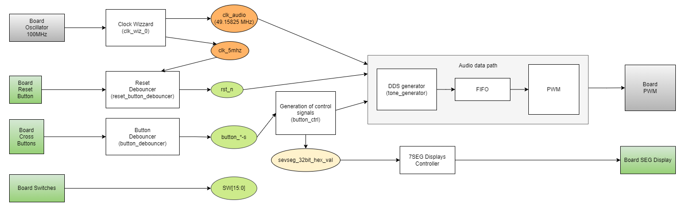
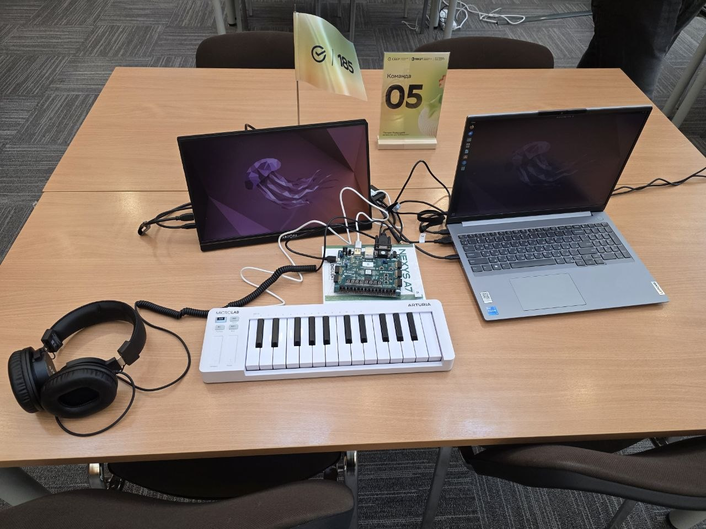
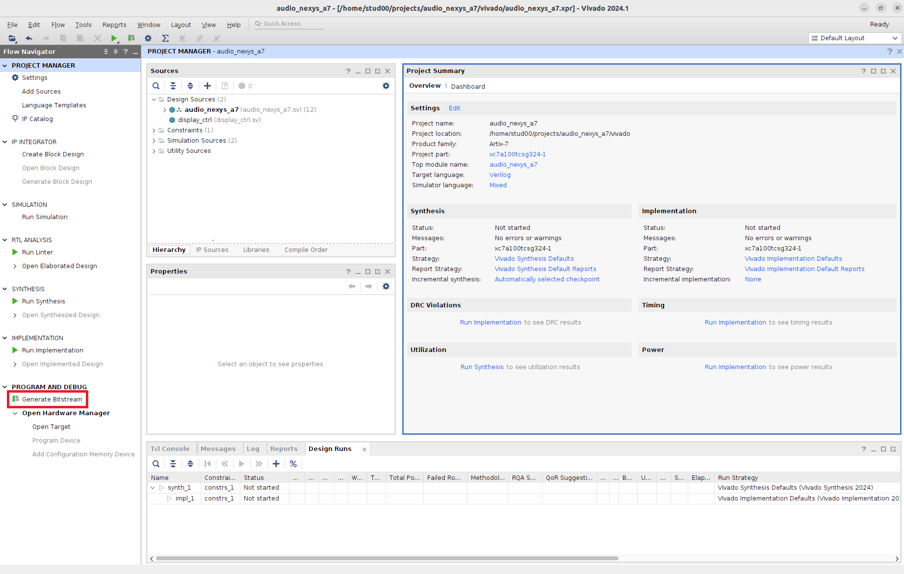
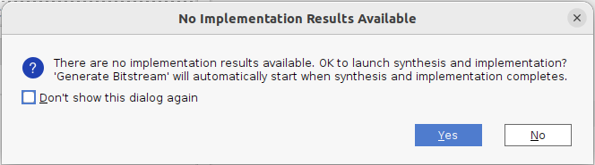
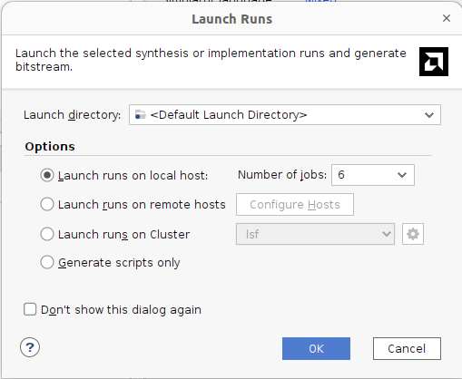
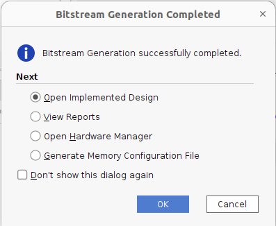
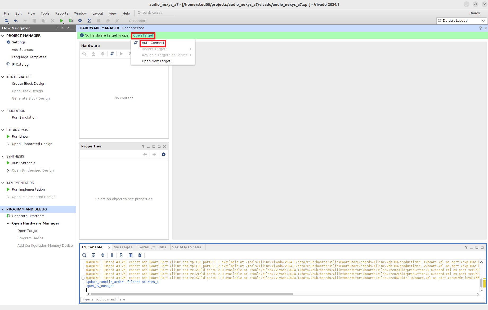
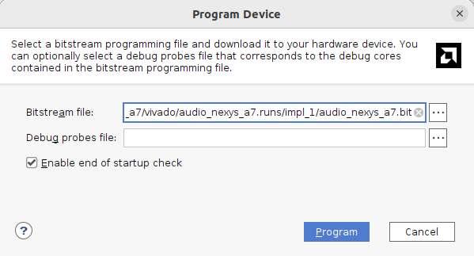

# Описание демонстрационного проекта audio_nexs_a7

Демонстрационный проект представляет собой **аппаратный синтезатор нот** на FPGA. 
Звук генерируется методом **DDS (Direct Digital Synthesis)**, буферизуется в FIFO и воспроизводится через встроенный ШИМ-усилитель платы.
Отдельным каналом реализован канал вывода графики на VGA, состоящий из контроллера сигналов дисплея и модуля вывода графической информаци `vga_demo`.

Управление синтезатором:

* **BTNC** — Play / Pause;
* **BTNU / BTND** — громче / тише (16 уровней);
* **BTNL / BTNR** — предыдущая / следующая нота (C, D, E, F, G, A, B);
* **SW[2:0]** — выбор октавы (1–8);
* **CPU_RESETN** — сброс в состояние по умолчанию (Play=0, громкость=8, нота=C).

Ниже представлена структурная схема FPGA проекта.


* ### Clock Wizard

Vivado IP-блок из IP Catalog (см. Инструкция Vivado). Из опорной частоты 100 МГц (кварц платы) блок формирует три тактовых сигнала:

* **`clk_audio` — 49.15865 МГц** — основной домен дизайна. 49.15865 МГц / 1024 ≈ 48 006 Гц — частота дискретизации звука;
* **`clk_5mhz0d` — ≈5 МГц (4.993)** — медленный домен для периферии: синхронизатор сброса в модуле `reset_button_debouncer`, делитель для семисегментных индикаторов;
* **`pixel_clk` — ≈40 МГц (39.941)** — частота пикселей для VGA в режиме SVGA 800×600@60 Гц (полная строка 1056 пикселей, кадр 628 строк, ≈60.2 кадра в секунду). От него работает демонстрационный вывод на VGA (раздел «VGA»).

```
clk_wiz_0 clk_gen (
  .clk_in1  ( CLK100MHZ       ),
  .resetn   ( pll_rst_n       ),
  .clk_out1 ( clk_audio       ),  // 49.15865 MHz
  .clk_out2 ( clk_5mhz0d      ),  // 4.993 MHz
  .clk_out3 ( pixel_clk       ),  // 39.941 MHz
  .locked   ( pll_locked      )
);
```

Все три клока даёт один блок MMCM (VCO = 100 МГц / 8 × 51.125 = 639.06 МГц, делители 13, 128 и 16). Частоты подобраны вручную, потому что точные 49.152 и 40 МГц одновременно из одного MMCM получить нельзя. Если будете менять Clocking Wizard, проверьте вкладку MMCM Settings: мастер сам может подобрать другие значения.

**Все клоки асинхронны друг другу.** В `audio_nexys_a7.xdc` они объявлены через `set_clock_groups -asynchronous`.
Поэтому сброс `rst_n` (он приходит из домена 5 МГц) в каждый домен заводится через свой синхронизатор `reset_sync`: в домене `clk_audio` вся логика сбрасывается от `aud_rst_n`, в домене `pixel_clk` — от `pix_rst_n`. Сброс включается сразу, а снимается по фронту своего клока через два триггера, поэтому все триггеры домена выходят из сброса на одном такте. Если добавляете свой модуль, подключайте к нему сброс своего домена, а не `rst_n`. Передавать данные между `clk_audio` и `pixel_clk` можно только через синхронизатор из двух триггеров (для одиночных медленных флагов), двухпортовую блочную память или асинхронный FIFO. Прямое подключение регистра одного домена к логике другого даст случайные сбои, которые Vivado не покажет в отчёте о таймингах.

* ## Reset & Buttons Debouncers

Кнопки — один из самых старых и популярных интерфейсов человек-машина. 
Когда пользователь нажимает на кнопку, она замыкает электрическую цепь, позволяя току течь через неё. 
Это замыкание может быть использовано для включения, выключения или управления другим устройством, в нашем случае FPGA. Механические кнопки могут создавать дребезг при нажатии, что выражается в скачках напряжения. 
Для того чтобы избавить сигнал от дребезга используются специальные схемы, называемые дебаунсеры, их задача анализировать сигнал, подаваемый с кнопки и отсекать изменения сигнала, длина которых меньше определенного времени фильтрации.
У кнопки Reset и других кнопок различная полярность. 
**Рекомендуется не изменять данные модули и использовать только сигналы, полученные после фильтрации.**

```
reset_button_debouncer reset (
  .clk_100mhz   ( CLK100MHZ  ),
  .clk_5mhz     ( clk_5mhz0d ),
  .reset_button ( CPU_RESETN ),
  .pll_rst_n    ( pll_rst_n  ),
  .pll_locked   ( pll_locked ),
  .rst_n        ( rst_n      )
);
...
button_debouncer dbns_center (
  .clk         ( clk_audio  ),
  .arst_n      ( rst_n      ),
  .sw_i        ( BTNC       ),
  .sw_state_o  ( button_c   ),
  .sw_down_o   ( button_c_d ),
  .sw_up_o     ( button_c_u )
);
```

* ### Board Switches

Помимо кнопок на плате существуют еще 16 переключателей (Switches).
Их значения доступны в верхнем модуле через сигналы `SW[15:0]`.
Демонстрационный проект использует крайние правые три переключателя `SW[2:0]` для выбора октавы.

```
input   logic  [15:0]    SW        ,
```

* ### 7SEG display

На плате есть 8 семисегментных индикаторов. Для них в проекте есть готовый контроллер `src/rtl/sevseg_ctrl.sv`.

Контроллер принимает 32 бита данных, по 4 бита на каждый разряд, и выводит их в шестнадцатеричном виде (0…F). Разряды горят по очереди (динамическая индикация): сегменты общие для всех разрядов, а нужный разряд включается своим анодом. Сегменты и аноды включаются низким уровнем.

* ### Модуль управления

Данный модуль принимает одиночные импульсы кнопок от дебаунсеров и формирует три управляющих регистра:

* `play` — флаг Play/Pause, переключается по импульсу BTNC;
* `volume[3:0]` — громкость 0–15, стартовое значение 8; BTNU → +1
  (до 15), BTND → −1 (до 0);
* `note_index[2:0]` — номер ноты 0–6, круговое переключение:
  BTNR → +1, BTNL → −1.

В верхнем модуле импульсы подключены к выходам `sw_up_d` дебаунсеров, то есть изменение настройки применяется в момент нажатия кнопки.

```
button_ctrl button_ctrl_inst (
  .clk         ( clk_audio  ),
  .rst_n       ( rst_n      ),
  .button_c    ( button_c_d ),
  .button_u    ( button_u_d ),
  .button_d    ( button_d_d ),
  .button_r    ( button_r_d ),
  .button_l    ( button_l_d ),
  .play        ( play       ),
  .volume      ( volume     ),
  .note_index  ( note_index )
);
```

* ### Tone Generator

Генератор тона реализует **метод прямого цифрового синтеза (DDS)**.
Внутри модуля находится 32-битный фазовый аккумулятор, который на каждом такте увеличивается на вычисленный инкремент. 
Сам инкремент хранится константами `INCREMENT_C4…INCREMENT_B4`, по одной
на каждую из семи нот 4-й октавы, и рассчитывается по формуле:

```
increment = f_note * 2^32 / f_sample
```

Сигнал `note_index` выбирает базовую ноту, а `octave_sel` (значение`SW[2:0]`) сдвигает инкремент на octave_sel позиций,
меняя частоту ноты степенями двойки — так покрываются 8 октав.

Выходной сэмпл — старшие 16 бит аккумулятора
(`sample = duty[31:16]`): пилообразная волна. Сигнал `valid` всегда равен 1 — данные валидны каждый такт; 
темпом выдачи управляет потребитель (в текущей реализации PWM) через сигнал `ready`.

```
tone_generator tone_generator_inst (
  .clk         ( clk_audio  ),
  .rst_n       ( rst_n       ),
  .note_index  ( note_index  ),
  .octave_sel  ( SW [2:0]    ),
  .sample      ( sample      ),
  .valid       ( valid       ),
  .ready       ( ready       )
);
```
Настройка громкости производится следующим образом:

```
vol_mult      = sample * volume
sample_scaled = vol_mult[19:4]     
```

* ### FIFO

Кольцевой буфер размером 256 слов × 32 бита, развязывающий темп генерации сэмплов и темп их выдачи ШИМ. 
Запись в FIFO выполняется только при `ready = play && !fifo_full`.
В старшей половине слова записываются нули (`fifo_wr_data = {16'b0, sample_scaled}`).

```
fifo fifo_inst (
  .clk     ( clk_audio    ),
  .rst_n   ( rst_n        ),
  .wr_data ( fifo_wr_data ),
  .wr_en   ( fifo_wr_en   ),
  .full    ( fifo_full    ),
  .rd_data ( fifo_rd_data ),
  .rd_en   ( fifo_rd_en   ),
  .empty   ( fifo_empty   )
);
```

* ### PWM

Модуль преобразует 32-битные слова из FIFO в однобитный ШИМ-сигнал `aud_pwm = ( count <= duty )`.
Когда счетчик достигает максимума, модуль читает следующее слово из
FIFO. Итоговые частота дискретизации `f_sample = 49 158 650 / 1024 ≈ 48.006 кГц`

Сигнал `aud_en` включает встроенный усилитель платы только при наличии данных, а при пустом FIFO усилитель глушится.

```
pwm pwm_inst (
  .clk          ( clk_audio    ),
  .rst_n        ( rst_n        ),
  .aud_pwm      ( AUD_PWM      ),
  .aud_en       ( AUD_SD       ),
  .fifo_rd_data ( fifo_rd_data ),
  .fifo_rd_en   ( fifo_rd_en   ),
  .fifo_empty   ( fifo_empty   )
);
```

* ### VGA

Видеотракт целиком работает в домене `pixel_clk` и со звуком не связан.

```
display_ctrl (тайминги 800×600@60) → h_coord, v_coord → vga_demo → red, green, blue
                                   → h_sync, v_sync, disp_enbl ─→ регистр в топе → VGA_R/G/B, VGA_HS, VGA_VS
```

**`display_ctrl`** генерирует координаты пикселя `h_coord` (0…1055) и `v_coord` (0…627), который выводится сейчас, начиная с верхнего левого угла. Видимая область — `h_coord < 800`, `v_coord < 600`, вне её `disp_enbl = 0` и цвет должен быть чёрным (это делает регистр в топе). Ещё модуль формирует сигналы синхронизации `h_sync` и `v_sync` для монитора. Цвет каждого пикселя нужно посчитать за один такт `pixel_clk` (25 нс).

**`vga_demo`** — пример картинки: первые ~5 секунд после сброса в центре экрана показывается логотип 128×128, потом две строки текста.

* Логотип хранится в `sber_logo_rom.sv` (16 384 пикселя по 12 бит, формат `{B, G, R}`, `12'h000` — прозрачный). Чтение синхронное, поэтому Vivado кладёт ROM в блочную память (6 блоков BRAM). Данные приходят на такт позже, поэтому адрес считается для следующего пикселя (`h_coord + 1`).
* Текст: шрифт 8×8 в `font_rom.sv` (пробел, `0`–`9`, `A`–`Z`, `- . : ! /`), каждая точка растянута в квадрат 4×4, символ занимает 32×32 пикселя. Строки задаются параметрами `TEXT_LINE0` / `TEXT_LINE1` (ровно 16 символов). Номер символа в строке — `(h_coord − 144) / 32`, то есть просто биты `[8:5]`, строка шрифта — биты `[4:2]` смещения по вертикали.

Чтобы вывести своё (название трека, время, громкость), меняйте `vga_demo`: например, держите строку в регистрах вместо параметра или добавьте в `font_rom` недостающие символы. Данные из домена `clk_audio` передавайте через синхронизатор или асинхронный FIFO.

## Описание отладки на Verilator

Внутри проекта присутствует возможность проверить часть функционала вашего модуля без прошивки на FPGA. 
Для этого используется программа Verilator, преобразующая HDL-код в C++, а также библиотека SDL2 для вывода графики и звука.

В папке SIM находятся два файла:

* top_audio.sv — топовый модуль на языке SystemVerilog, отчасти повторяющий топовый модуль FPGA проекта.
* main_audio.cpp — тестовое окружение на языке C++, используемое Verilator для воспроизведения нот, вывода картинки VGA и отрисовки семисегментных индикаторов, а также для управления сигналами объекта top_audio, созданного Verilator на основе top_audio.sv

Окно симулятора: сверху экран VGA 800×600 (то же, что `vga_demo` выводит на монитор), снизу семисегментные индикаторы. Размер окна можно менять мышью. Симулятор подаёт два клока: на каждые 16 тактов `clk_audio` приходится 13 тактов `pixel_clk`, как на плате (оба клока получены из одного VCO делением на 13 и 16).

Для формирования исполняемого файла используйте команду make.
После чего запустите исполняемый файл (obj_dir/audio). 

Симулятор позволяет быстрее отслеживать изменения в вашем проекте, но работает примерно в реальном времени, на пределе. Скорость показана в заголовке окна. Если она ниже 100%, звук будет прерываться: клавиша V замораживает картинку VGA (её клок перестаёт тактоваться), и звук снова идёт без пауз. Клавиша A делает обратное: останавливает клок `clk` всего звукового тракта, и картинка VGA рисуется примерно в полтора раза быстрее. Это удобно, когда отлаживаете только графику. Пока звук остановлен, не работают кнопки управления и не обновляются индикаторы: они тоже в домене `clk`. Чем больше логики вы добавите, тем медленнее будет симуляция.

Управление в окне симулятора:

| Клавиша | На плате | Действие |
|---|---|---|
| Пробел | BTNC | Play / Pause |
| ↑ / ↓ | BTNU / BTND | громче / тише |
| ← / → | BTNL / BTNR | предыдущая / следующая нота |
| 1 … 8 | SW[2:0] = 0 … 7 | октава 1 … 8 (4 — четвёртая октава, как `SW[2:0] = 3`) |
| V | — | заморозить / включить картинку VGA |
| A | — | остановить / запустить звуковой тракт |
| Q | — | выход из симулятора |

После запуска октава первая (как при `SW[2:0] = 0`), воспроизведение на паузе: нажмите пробел. Кнопки сброса `CPU_RESETN` в симуляторе нет, чтобы начать заново, перезапустите его.

## Быстрый старт

### 1. Сборка стенда

Данный раздел предлагается для более быстрого погружения в работу с предоставленным оборудованием, сборки стенда и проверки работоспособности всех его элементов.

Предоставляемое оборудование включает в себя:
1. Ноутбук с предустановленным необходимым ПО и зарядным устройством;
2. Отладочная плата Digilent Nexys A7 с кабелем Micro USB;
3. Наушники с кабелем Mini Jack 3,5;
4. HDMI Display c кабелем питания от ноутбука типа Type-C и кабелем подключения HDMI-micro HDMI;
5. Переходник VGA-HDMI с **кабелем питания** USB-Type A - micro USB;
6. SD флашека с записанной на ней MP3 композицией;
7. MIDI клаиватура.



### 2. Сборка проекта

Далее можно собрать предложенный организаторами демонстрационный проект.
Для этого откройте терминал на предоставленном ноутбуке и перейдите в корень репозитория:

```
cd <repository_dir>
```

Далее выполните команду `make deploy`, после чего откроется графический интерфейс проекта в Vivado как показано на рисунке ниже. 
Более подробное описание приведено в инструкции по использованию Vivado (файл 4_Инструкция_Vivado.docx).

Далее выполните команду `make deploy`, после чего откроется графический интерфейс проекта в Vivado, как показано на рисунке ниже. 



Для сборки прошивки нажмите кнопку *«Generate Bitstream»*, отмеченную на рисунке выше красным. 
Vivado предупредит о том, что требуется выполнить синтез и имплементацию прежде чем сгенерировать битстрим, и покажет
окно, которое приведено на рисунке ниже. Нажмите кнопку *«Yes»*.



Далее среда предоставит выбор настроек сборки — оставьте их по умолчанию и нажмите *«Ok»*.



Когда все будет выполнено, Vivado сообщит об этом, как показано на рисунке ниже. 
Выберите пункт *«Open Hardware Manager»*. Если вы по какой-либо причине не выбрали этот пункт, то можно открыть Hardware
Manager кнопкой под *«Generate Bitstream»* в меню *Project Navigator* слева, подробнее это описано в интрукции по использованию Vivado в репозитории к проекту.



### 3. Прошивка платы

После открытия *«Hardware manager»* нужно подключиться к отладочной плате: нажмите *«Open Target»*, затем *«Auto Connect»*, как показано на
рисунке ниже.



Когда плата определится средой, в окне *«Hardware»* появится информация об используемой ПЛИС как показано на рисунке ниже. Далее нажмите *«Program Device»*.

Появится окно для выбора *.bit файла — путь до сгенерированного ранее в рамках проекта файла будет выбран автоматически. Нажмите кнопку 
*«Program»*.



После появится индикатор загрузки. На этом прошивка платы завершена.
Также учитывайте, что при выключении питания платы загруженная прошивка
будет сброшена и при повторном включении произойдет загрузка заводской
прошивки из памяти платы.